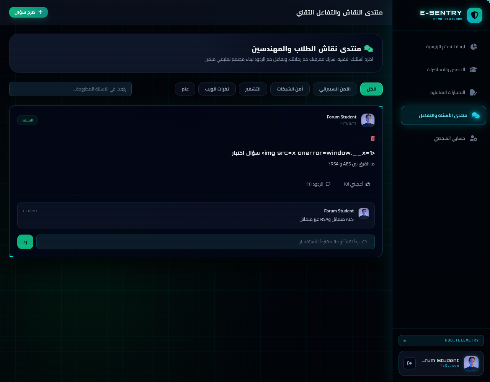

# 🎓 E-Sentry Academy



_Screenshot of the forum in server mode (local run)._

<div align="center">


**منصة تعليمية تجريبية - E-Sentry Academy (نموذج / demo)**

[🚀 Live Demo](#-demo) • [📖 Installation](#-installation) • [⚙️ Features](#-features) • [🤝 Contributing](#-contributing)

</div>

---

## 🎯 Overview

E-Sentry Academy هي منصة تعليمية تفاعلية مصممة للطلاب والمعلمين. توفر المنصة تجربة تعليمية متكاملة تشمل:

- 📚 **إدارة الدورات**: إنشاء وإدارة الدورات التعليمية بسهولة
- 📝 **الاختبارات**: نظام اختبارات متكامل مع تصحيح تلقائي
- 💬 **المنتديات**: تفاعل بين الطلاب والمعلمين
- 📊 **لوحة تحكم**: متابعة أداء الطلاب والإحصائيات

---

## ✨ Features

| Feature | Description |
|---------|-------------|
| 🏠 **Dashboard** | لوحة تحكم تفاعلية مع إحصائيات من بيانات الجلسة المحلية |
| 📚 **Courses** | إدارة الدورات والدروس بشكل كامل |
| 📝 **Exams** | نظام اختبارات مع أسئلة متعددة الخيارات |
| 💬 **Forum** | منتدى نقاش للطلاب والمعلمين |
| 👤 **User Roles** | دوران: طالب ومدير (لا يوجد دور معلم) |
| 🔔 **Notices** | رسائل تنبيه داخل الصفحة (لا يوجد إشعارات push) |
| 🌙 **Dark theme** | التصميم داكن فقط، لا يوجد زر تبديل |
| 📱 **Responsive** | متوافق مع جميع الأجهزة |

---

## 📸 Screenshots

The screenshot at the top is the only image, taken from a local server-mode run. Other pages were not re-captured.

---

## 🛠️ Tech Stack

### Frontend
- **HTML5**: Structure and semantics
- **CSS3**: Styling with custom properties
- **JavaScript (ES6+)**: Interactive features
- **Tailwind CSS**: Utility-first CSS framework
- **Chart.js**: Data visualization
- **Font Awesome**: Icons library

### Backend Scripts
- **Python**: Data processing scripts
  - `apply_exams.py`: Apply exam configurations
  - `expand_questions.py`: Expand question banks
  - `fill_30_questions.py`: Auto-fill questions
  - `patch_data.py`: Data migration tools

---

## 📁 Project Structure

```
platform/
├── index.html              # Main dashboard
├── courses.html            # Courses management
├── course-details.html     # Individual course view
├── lessons.html            # Lesson content
├── exams.html              # Exam interface
├── forum.html              # Discussion forum
├── login.html              # Authentication
├── register.html           # User registration
├── account.html            # User profile
├── admin.html              # Admin dashboard
├── css/
│   └── style.css           # Custom styles
├── js/
│   ├── app.js              # Main application
│   ├── auth.js             # Authentication
│   ├── dashboard.js        # Dashboard logic
│   ├── courses.js          # Course management
│   ├── exams.js            # Exam system
│   ├── forum.js            # Forum features
│   └── ...                 # Other modules
├── manifest.json           # PWA manifest
└── sw.js                   # Service worker
```

---

## 🚀 Getting Started

### Prerequisites

- Modern web browser (Chrome, Firefox, Edge)
- The static demo needs no server (runs client-side). An optional local backend prototype is in `server/` (see below)

### Installation

```bash
# Clone the repository
git clone https://github.com/mahamedwow1-afk/platform.git
cd platform

# Open index.html in your browser
# Or use a simple HTTP server:
python -m http.server 8080
```

### Optional: server mode (local prototype)
Requires Node 22. From the `server/` folder:

```bash
ADMIN_EMAIL=you@example.com ADMIN_PASSWORD='at-least-12-chars' node --no-warnings server.js
```

Then open the address it prints. In this mode accounts, sessions, exam scoring and the forum go through the server API. Tests and the full list of limits are in `server/README.md`. This is a prototype, not production: likes, course progress and some admin tables stay in the browser.

### Development

```bash
# Install Live Server for hot reload
npm install -g live-server

# Start development server
live-server
```

---

## ⚙️ Configuration

Edit `manifest.json` for PWA settings:

```json
{
  "name": "E-Sentry Academy",
  "short_name": "E-Sentry",
  "start_url": "/index.html",
  "display": "standalone",
  "background_color": "#010308",
  "theme_color": "#00f3ff"
}
```

---

## 🧪 Testing

The server prototype has its own test scripts in `server/` (see `server/README.md` for how to run them). The static pages have no automated tests.

---

## 🤝 Contributing

Contributions are welcome! Please follow these steps:

1. Fork the repository
2. Create a feature branch (`git checkout -b feature/AmazingFeature`)
3. Commit your changes (`git commit -m 'Add AmazingFeature'`)
4. Push to the branch (`git push origin feature/AmazingFeature`)
5. Open a Pull Request

---

## 📄 License

No license file is included yet.
---

## 👨‍💻 Author

**Mahamed Yasser**
- Full-Stack Developer
- Qalyubia, Egypt
- [GitHub Profile](https://github.com/mahamedwow1-afk)

---

## 🙏 Acknowledgments

- [Tailwind CSS](https://tailwindcss.com/) - For the amazing utility framework
- [Chart.js](https://www.chartjs.org/) - For beautiful charts
- [Font Awesome](https://fontawesome.com/) - For icons
- [Unsplash](https://unsplash.com/) - For placeholder images

---

<div align="center">

Made with ❤️ by [Mahamed Yasser](https://github.com/mahamedwow1-afk)

</div>


---

## 🔐 Security notes (read before using)

This is a **static front-end demo**. Accounts, courses, forum posts and grades are stored in the browser (`localStorage`). There is no server, so it must **not** be used with real student data as-is.

What the demo does:
- No default admin password in the source. The first admin sign-in in a browser sets the password (10+ characters), kept as a salted PBKDF2-SHA256 hash.
- Student passwords are stored as salted PBKDF2 hashes (old plain-text records are upgraded on next login).
- Forum, account and admin views escape user-supplied text (stored-XSS tested with payloads in title, content, category, author, avatar and replies).
- Client-side login throttling (5 failures, 30 s) and a Content-Security-Policy meta tag.

What it cannot do (needs a real backend): server-side authentication and authorization, rate limiting that an attacker cannot reset, encrypted storage, audit logs, backups. Anyone with browser dev tools can edit local data.
